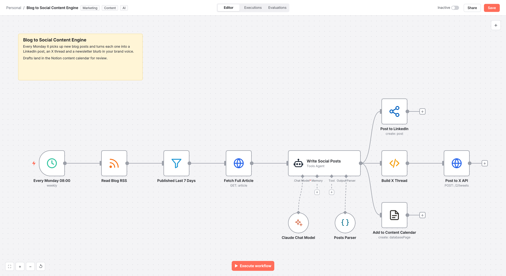

# Blog to Social Content Engine

Repurposes new blog posts into LinkedIn posts, X threads and newsletter copy with Claude, then publishes and logs them in Notion.

## The problem

Marketing teams publish great articles but rarely have time to adapt each one for every channel.

## How it works

1. Weekly schedule reads the blog RSS feed and keeps only posts from the last 7 days
2. The full article is fetched so the model works from the real content, not just the excerpt
3. Claude writes channel specific copy in brand voice and returns it as structured JSON
4. LinkedIn is posted directly, the X thread is split into ordered posts and sent with rate limited batching
5. Every draft is added to the Notion content calendar for review and reporting

## Stack

n8n, Anthropic Claude, LinkedIn, X API, Notion, RSS

## Outcome

One article becomes a week of social content with zero copy and paste.

## Import

1. In n8n, open **Workflows > Import from File** and select `workflow.json`.
2. Add your credentials to the nodes that show a warning.
3. Replace placeholder IDs (sheets, channels, databases, phone numbers) with your own.
4. Run once with test data, then activate.

Nodes: 11 | Built for n8n 1.x
