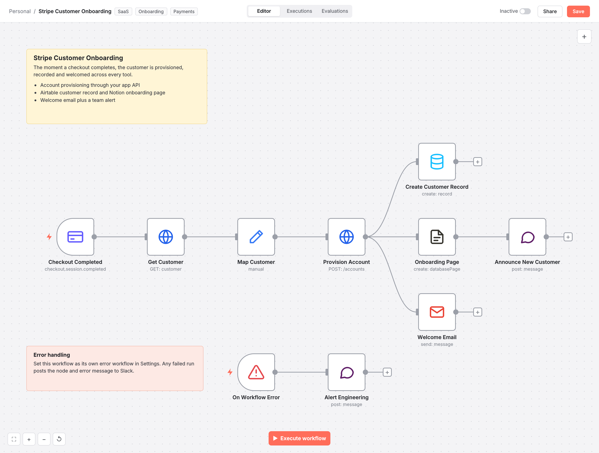

# Stripe Customer Onboarding

Provisions new SaaS customers the second a Stripe checkout completes and syncs them to Airtable, Notion, Gmail and Slack, with error alerting.

## The problem

New customers wait for manual setup and the team learns about sales from a bank statement.

## How it works

1. Stripe trigger listens for checkout.session.completed and fetches the full customer object
2. Customer, plan and MRR are mapped once and reused downstream
3. The app API provisions the account with automatic retries
4. In parallel: Airtable customer record, Notion onboarding page and a welcome email with the login link
5. Slack announces the new customer; an Error Trigger posts any failure with a link to the execution

## Stack

n8n, Stripe, REST APIs, Airtable, Notion, Gmail, Slack

## Outcome

Time to first login drops to seconds and no customer falls through the cracks.

## Import

1. In n8n, open **Workflows > Import from File** and select `workflow.json`.
2. Add your credentials to the nodes that show a warning.
3. Replace placeholder IDs (sheets, channels, databases, phone numbers) with your own.
4. Run once with test data, then activate.

Nodes: 10 | Built for n8n 1.x
