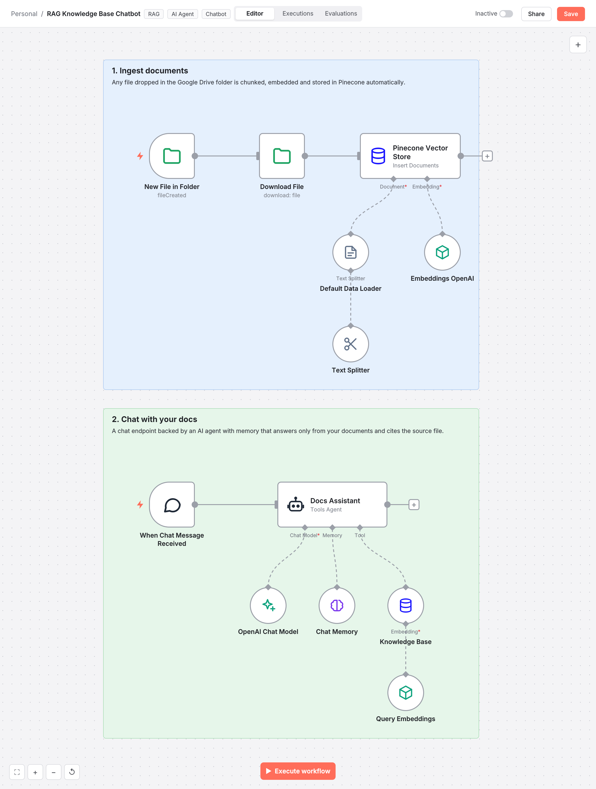

# RAG Knowledge Base Chatbot

A two part RAG system: Google Drive documents are embedded into Pinecone automatically, and a chat agent with memory answers from them with citations.

## The problem

Teams and customers cannot find answers buried in dozens of PDFs and docs.

## How it works

1. Ingestion: Drive trigger downloads new files, splits them into overlapping chunks and stores OpenAI embeddings in Pinecone with source metadata
2. Chat: a public chat trigger starts a session with a window memory
3. The agent retrieves the top matching chunks as a tool and is instructed to answer only from them and cite the file
4. The same index and namespace keep ingestion and retrieval in sync

## Stack

n8n, OpenAI, Pinecone, Google Drive, LangChain, RAG

## Outcome

A grounded assistant that stays current every time someone adds a document to the folder.

## Import

1. In n8n, open **Workflows > Import from File** and select `workflow.json`.
2. Add your credentials to the nodes that show a warning.
3. Replace placeholder IDs (sheets, channels, databases, phone numbers) with your own.
4. Run once with test data, then activate.

Nodes: 12 | Built for n8n 1.x
