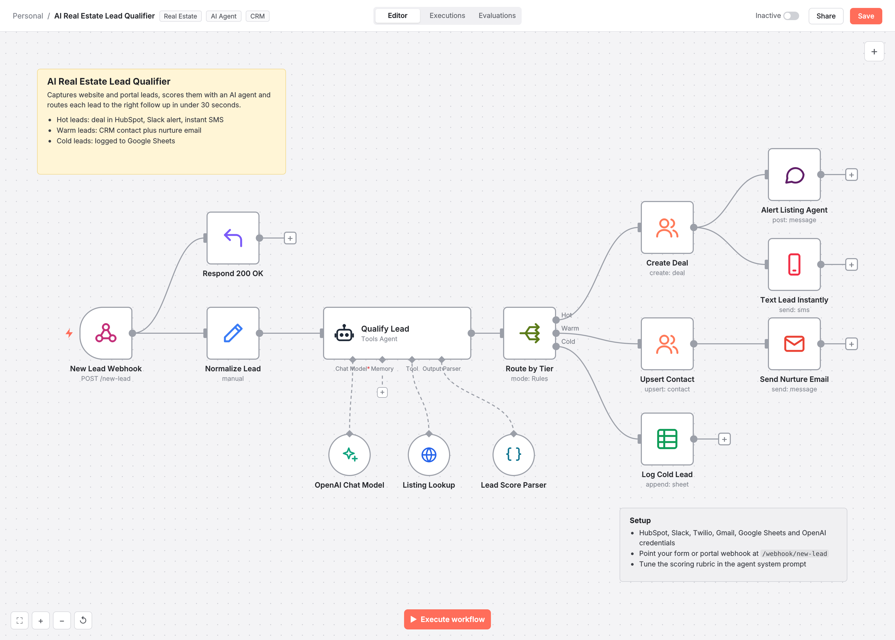
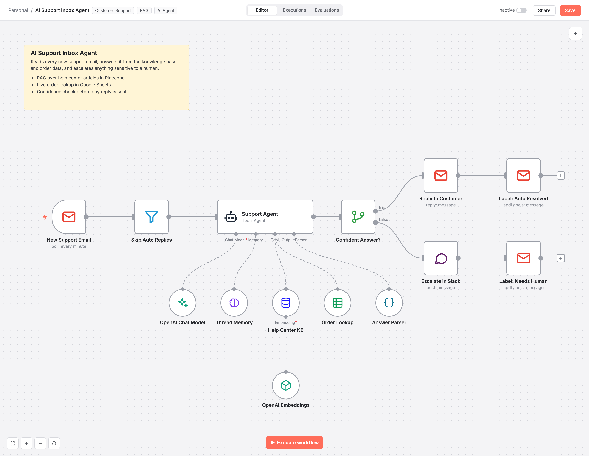
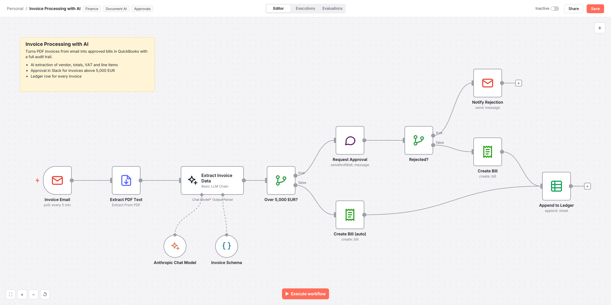
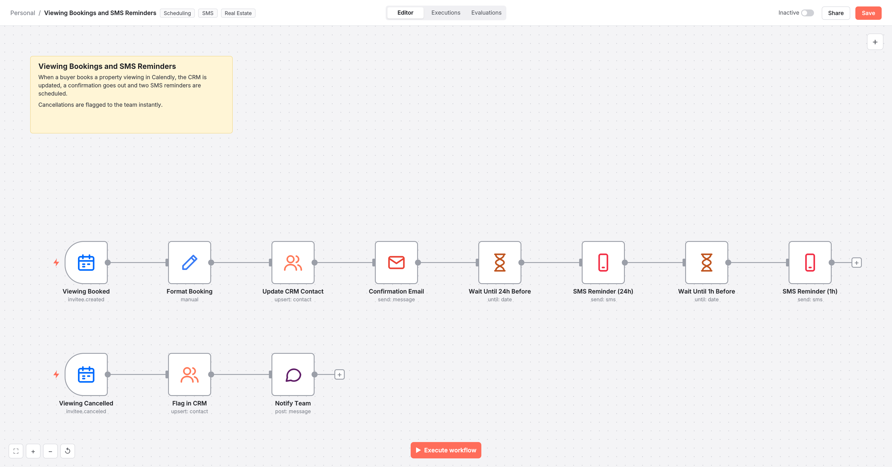
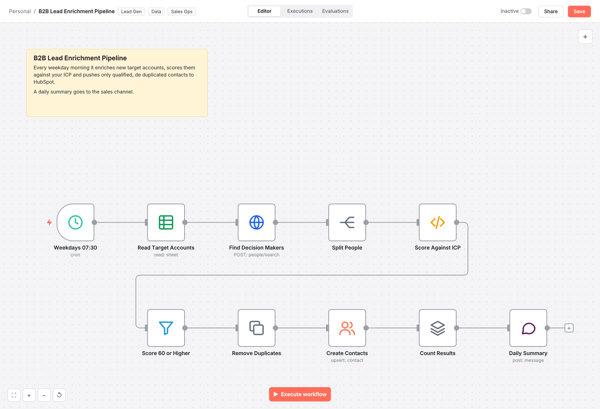

# n8n Automation Workflows

Production style n8n workflows covering AI agents, RAG, lead generation, finance ops and customer onboarding. Every workflow is a real, importable `workflow.json` with its own documentation.

| Workflow | What it does | Key integrations |
|---|---|---|
| [AI Real Estate Lead Qualifier](01-real-estate-lead-qualifier) | Scores inbound property leads with an AI agent and routes hot, warm and cold leads to the right follow up automatically. | OpenAI, HubSpot, Slack, Twilio |
| [AI Support Inbox Agent (RAG + Tools)](02-ai-support-inbox-agent) | An AI agent that answers support emails from a Pinecone knowledge base and live order data, with a confidence gate and human escalation. | OpenAI, Pinecone, Gmail, Google Sheets |
| [AI Invoice Processing and Approvals](03-invoice-processing) | Extracts structured data from PDF invoices with an LLM, routes large invoices for Slack approval and books bills in QuickBooks. | Anthropic Claude, Gmail, Slack, QuickBooks |
| [Blog to Social Content Engine](04-content-repurposing-engine) | Repurposes new blog posts into LinkedIn posts, X threads and newsletter copy with Claude, then publishes and logs them in Notion. | Anthropic Claude, LinkedIn, X API, Notion |
| [Booking Confirmations and SMS Reminders](05-booking-reminders) | Calendly bookings update HubSpot, send a confirmation and schedule 24 hour and 1 hour SMS reminders; cancellations alert the team. | Calendly, HubSpot, Gmail, Twilio |
| [Stripe Customer Onboarding](06-stripe-customer-onboarding) | Provisions new SaaS customers the second a Stripe checkout completes and syncs them to Airtable, Notion, Gmail and Slack, with error alerting. | Stripe, REST APIs, Airtable, Notion |
| [RAG Knowledge Base Chatbot](07-rag-knowledge-chatbot) | A two part RAG system: Google Drive documents are embedded into Pinecone automatically, and a chat agent with memory answers from them with citations. | OpenAI, Pinecone, Google Drive, LangChain |
| [B2B Lead Enrichment and Scoring Pipeline](08-lead-enrichment-pipeline) | Daily pipeline that finds decision makers for target accounts, scores them against an ICP, de duplicates and syncs qualified contacts to HubSpot. | Apollo API, Google Sheets, HubSpot, Slack |

## What these show

- **AI agents with tools, memory and structured output** (OpenAI and Anthropic Claude through n8n LangChain nodes)
- **RAG pipelines**: document ingestion into Pinecone and grounded retrieval with citations
- **Human in the loop**: confidence gates, Slack approvals with send and wait, escalation paths
- **Reliability**: retries, rate limited batching, de duplication and an error workflow that alerts on failure
- **Clean builds**: named nodes, sticky note documentation and no hard coded secrets

## Gallery

### [AI Real Estate Lead Qualifier](01-real-estate-lead-qualifier)

Scores inbound property leads with an AI agent and routes hot, warm and cold leads to the right follow up automatically.

### [AI Support Inbox Agent (RAG + Tools)](02-ai-support-inbox-agent)

An AI agent that answers support emails from a Pinecone knowledge base and live order data, with a confidence gate and human escalation.

### [AI Invoice Processing and Approvals](03-invoice-processing)

Extracts structured data from PDF invoices with an LLM, routes large invoices for Slack approval and books bills in QuickBooks.

### [Blog to Social Content Engine](04-content-repurposing-engine)

Repurposes new blog posts into LinkedIn posts, X threads and newsletter copy with Claude, then publishes and logs them in Notion.

### [Booking Confirmations and SMS Reminders](05-booking-reminders)

Calendly bookings update HubSpot, send a confirmation and schedule 24 hour and 1 hour SMS reminders; cancellations alert the team.

### [Stripe Customer Onboarding](06-stripe-customer-onboarding)

Provisions new SaaS customers the second a Stripe checkout completes and syncs them to Airtable, Notion, Gmail and Slack, with error alerting.

### [RAG Knowledge Base Chatbot](07-rag-knowledge-chatbot)

A two part RAG system: Google Drive documents are embedded into Pinecone automatically, and a chat agent with memory answers from them with citations.

### [B2B Lead Enrichment and Scoring Pipeline](08-lead-enrichment-pipeline)

Daily pipeline that finds decision makers for target accounts, scores them against an ICP, de duplicates and syncs qualified contacts to HubSpot.

## Using a workflow

1. Download the `workflow.json` from the workflow folder.
2. In n8n choose **Import from File**.
3. Connect your credentials and replace the placeholder IDs.
4. Test with sample data, then activate.

## Need something similar?

I design and build custom automations, AI agents and integrations with n8n, APIs and code. Open an issue or reach out through my profile.
